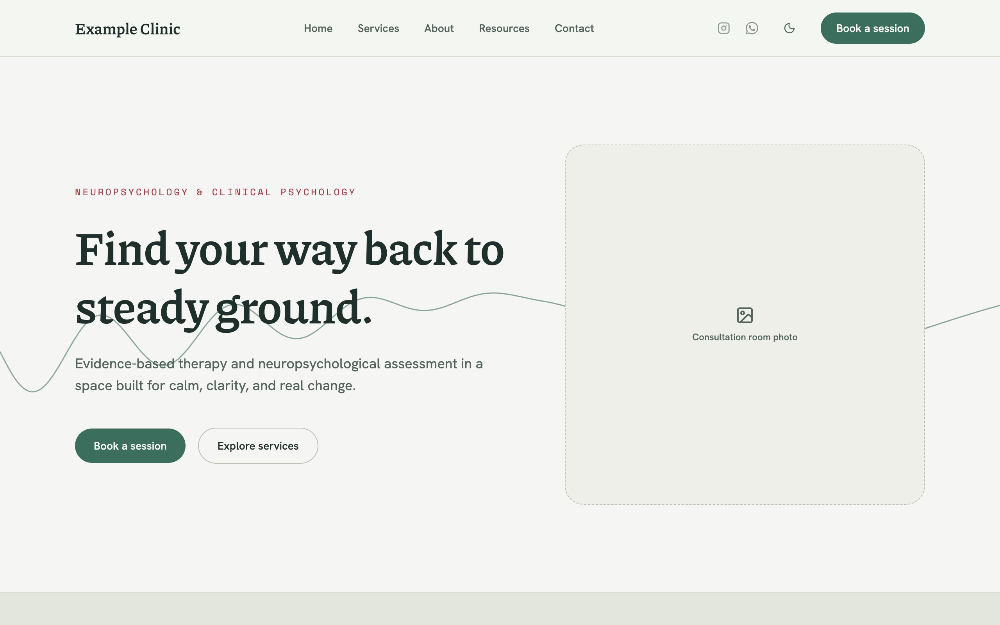
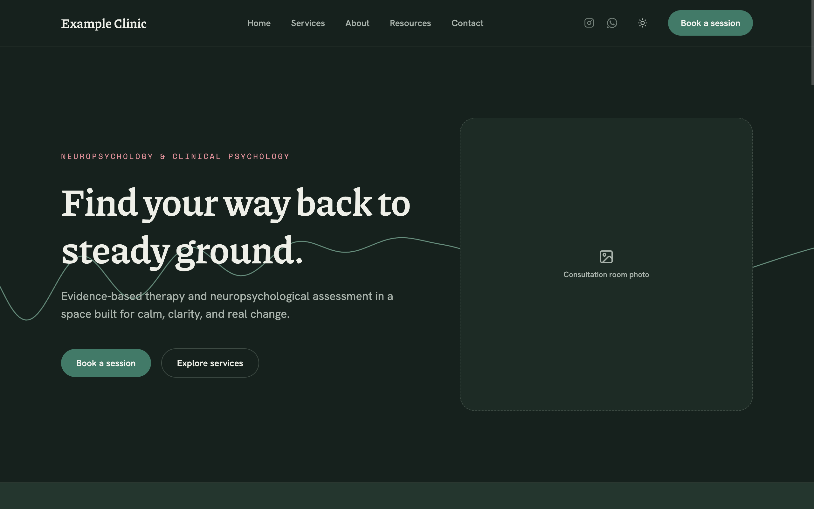
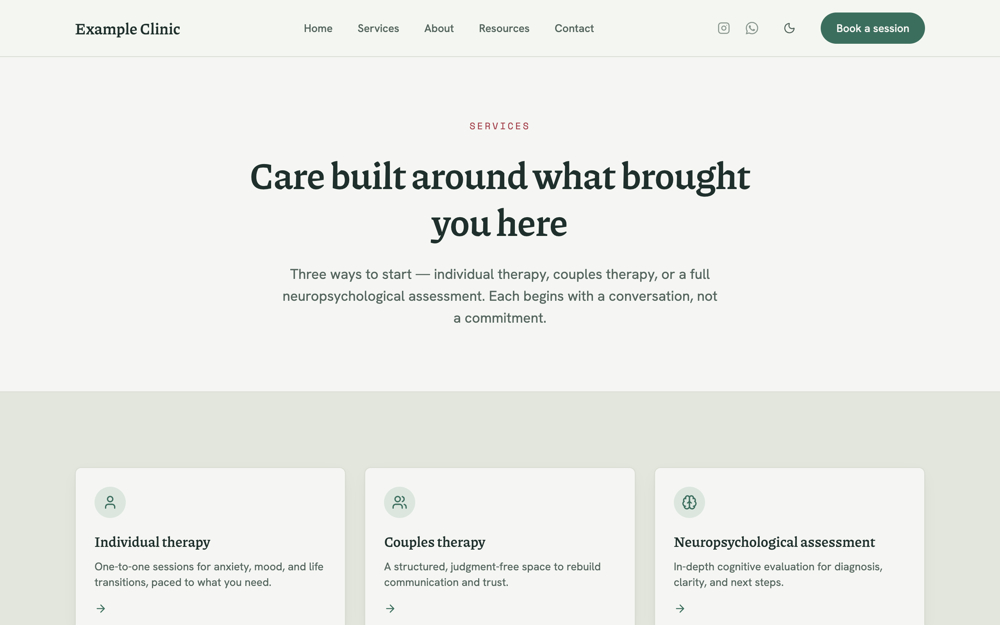
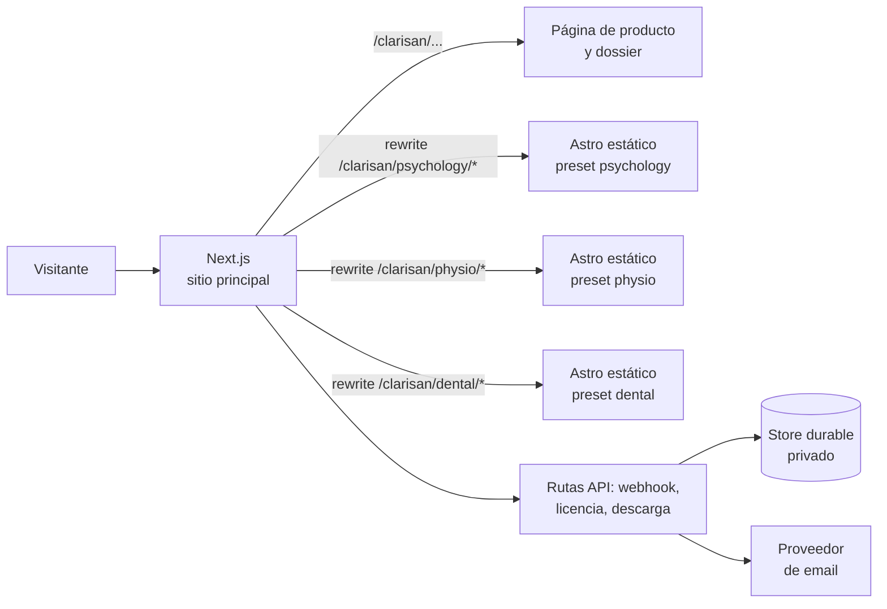
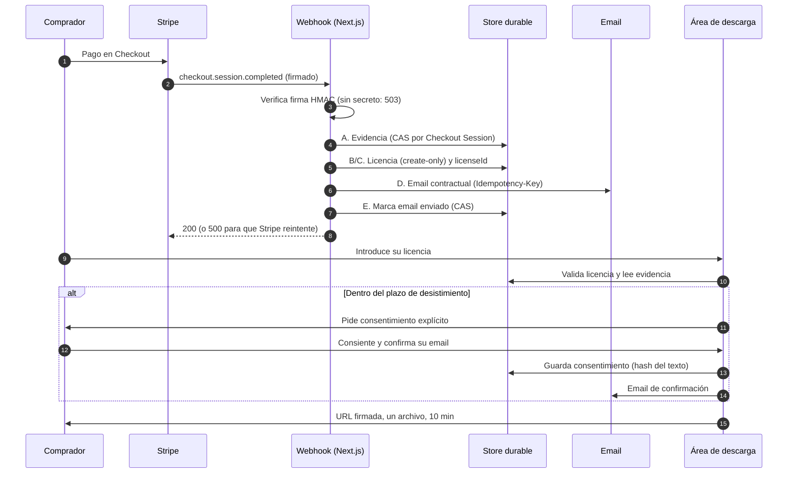

# Clarisan — Plantilla web estática y flujo de compra propio, de Stripe a descarga protegida

> Una plantilla Astro con tres presets visuales, servida bajo un único dominio con Next.js Multi-Zones, y un flujo de compra construido a mano: webhook con firma verificada, fulfillment idempotente, licencias derivadas con HMAC y descarga protegida con consentimiento de desistimiento.

**English summary.** Clarisan is a static Astro 7 website template for healthcare practices with three independently designed presets, plus the commerce flow around it, written from scratch in Next.js. Stripe Checkout feeds a signature-verified, idempotent webhook that records evidence, derives a license key deterministically (HMAC) and sends the contract email; the download area validates the license, records the buyer's withdrawal-right consent and issues a short-lived, single-file signed URL. The demos are served under one domain through Next.js Multi-Zones. The source code is private because it is a commercial product; I'm happy to walk through it in an interview.

## Enlaces

- **Dossier técnico:** <https://fherrera.dev/clarisan/dossier-tecnico>
- **Demos en vivo** (una por preset):
  - Psicología: <https://fherrera.dev/clarisan/psychology/>
  - Fisioterapia: <https://fherrera.dev/clarisan/physio/>
  - Dental: <https://fherrera.dev/clarisan/dental/>

## Capturas

Capturas de las demos públicas, con contenido de ejemplo.

| Psicología | Fisioterapia | Dental |
|---|---|---|
|  |  |  |

## Qué es

Una plantilla web estática en Astro para consultas sanitarias, con tres presets (psicología, fisioterapia, dental) y el sistema propio de cobro, licencias y descarga que la acompaña.

## Arquitectura de despliegue

La plantilla se compila una vez por preset (`PRESET`, `LOCALE`, `SITE_URL` y `BASE_PATH` por variable de entorno) y cada build es un proyecto estático independiente. El sitio personal, en Next.js, reescribe las rutas `/clarisan/{preset}/*` hacia cada proyecto (Multi-Zones), de modo que las tres demos viven bajo el mismo dominio.

## Flujo de compra

## Decisiones técnicas destacadas

**Idempotencia por compra, no por evento.** Stripe puede entregar el mismo evento varias veces o varios eventos para una misma sesión (`completed` y `async_payment_succeeded`). El handler trata la Checkout Session como clave de idempotencia y ejecuta cinco pasos (evidencia, licencia, `licenseId`, email, marca de envío). Cada paso se persiste antes de intentar el siguiente, y un `event.id` ya visto no corta el proceso si el fulfillment sigue incompleto. Así, un fallo a medias se recupera con un simple reintento. Las escrituras usan control de concurrencia optimista (compare-and-set con versión y reintentos acotados), y los emails llevan una `Idempotency-Key` determinista como defensa en profundidad. El riesgo residual de una carrera entre dos ejecuciones simultáneas está documentado en el propio código.

**Verificación de firma y fail closed.** El webhook verifica la firma HMAC de Stripe sobre el cuerpo en bruto antes de procesar nada. Sin secreto configurado responde 503 en vez de aceptar eventos sin verificar. Una firma inválida devuelve 400 y un fallo interno devuelve 500, para que Stripe reintente solo lo que es transitorio. Otros fallos se tratan igual: sin versiones legales resueltas para esa compra, no se emite licencia ni se envía el contrato.

**Licencias derivadas, no almacenadas.** La clave se deriva con HMAC-SHA256 desde un secreto maestro, con separación de dominios, a partir del identificador de la compra. Es determinista: un reenvío reconstruye exactamente la misma clave y nunca crea otra, y no hace falta guardar el secreto de la licencia. El parser del formato es estricto y las comparaciones de secretos se hacen en tiempo constante. La emisión es de solo creación y nunca reactiva una licencia revocada.

**Descarga con alcance mínimo.** El ZIP vive en un store privado y nunca es público. Tras validar la licencia, se emite una URL firmada nativa de Vercel Blob, limitada a un único archivo, a la operación de lectura y a 10 minutos de vida. Si caduca, el comprador vuelve a validar su licencia y obtiene otra. Los errores no revelan qué dato falló (licencia inexistente, email distinto, etc.).

**Consentimiento de desistimiento.** Dentro del plazo de desistimiento, la descarga exige consentimiento explícito. El flujo guarda el momento del consentimiento y el hash del texto aceptado, envía un email de confirmación y es idempotente: repetir la llamada nunca vuelve a pedir el consentimiento ni a reenviar el email. Si el plazo vence mientras el usuario decide, el acceso se concede sin exigirlo. Las versiones de los textos legales se fijan por compra, a partir de los metadatos de esa Checkout Session.

**Multi-Zones con `base` de Astro.** Para servir un sitio multipágina bajo una subruta no basta con un proxy. `base` de Astro reescribe los enlaces que genera él mismo, pero no toca los `href` escritos a mano ni mueve la carpeta de salida. Lo resolví con un helper `withBase()` para los enlaces internos y un paso de `postbuild` que anida `dist/` bajo la subruta. Con la variable sin definir, el build es idéntico byte a byte al de antes (lo comprobé con `diff -r`).

**Contraste calculado, no supuesto.** Los tres presets (paleta clara y oscura) se diseñaron comprobando con un script el contraste WCAG de cada pareja texto/fondo real, incluidos los tonos suaves usados como fondo de etiquetas. Después se confirmó con Lighthouse sobre las demos desplegadas (97–100 en las cuatro categorías). El script fue una herramienta de diseño y no forma parte de los repositorios. El modo oscuro usa selectores compuestos por preset para evitar ambigüedad de especificidad entre presets.

## Calidad y tests

Lo que existe hoy, sin extrapolar:

- **Flujo de compra (Next.js):** 214 tests en 25 archivos con Vitest, todos pasando en la última ejecución. Cubren verificación de firma del webhook, el handler de eventos, el store con control optimista, formato y derivación de licencias, validación de licencia, orquestación de descarga, URL firmada, texto y hash de consentimiento, desistimiento, plantillas de email y versiones legales.
- **CI del sitio (Next.js):** ejecuta lint y build. La suite de Vitest no está todavía en el pipeline; se ejecuta en local.
- **Plantilla Astro:** no tiene suite de tests. Su CI ejecuta `astro check` (tipos y diagnósticos) y el build. Los cambios visuales se validan con Lighthouse (97–100 en las demos desplegadas) y revisión manual en navegador.
- No hay medición de cobertura ni tests end-to-end automatizados.

## Stack por capa

| Capa | Tecnologías |
|---|---|
| Plantilla | Astro 7 (salida estática), Tailwind CSS 4, TypeScript, Fontsource, astro-icon |
| Contenido e i18n | Content collections con Zod, diccionarios tipados por preset e idioma |
| Sitio y backend | Next.js 16, React 19, rutas API en runtime Node.js, TypeScript |
| Pagos | Stripe (Checkout, webhooks firmados) |
| Persistencia y archivos | Vercel Blob (store privado, URLs firmadas) |
| Email | Resend, con claves de idempotencia |
| Tests y CI | Vitest, GitHub Actions |
| Despliegue | Vercel, Multi-Zones |

## Código privado

El código es privado porque Clarisan es un producto comercial. Puedo enseñarlo y recorrerlo en una entrevista.

## Contacto

[contacto@fherrera.dev](mailto:contacto@fherrera.dev) · [fherrera.dev](https://fherrera.dev)
